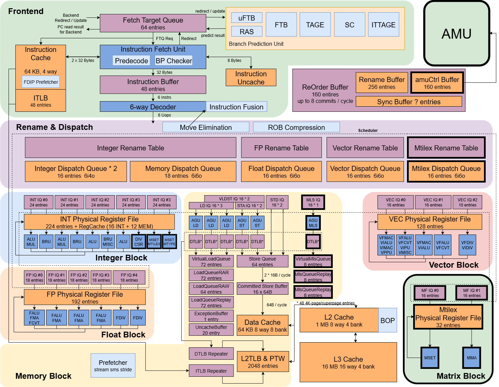

# XSAI（香山·香炉峰）

XSAI（香山·香炉峰）是面向通用计算与 AI 推理的开源 RISC-V 处理器项目。

> 香山原生的通推一体 AI CPU

XSAI 基于香山（XiangShan，XS）演进而来，即 **XSAI = XS + AI**。技术方案以香山昆明湖 V2 微架构为基础，在保留通用处理器编程模型的同时，增加 AI 矩阵计算和面向 AI 负载的存储系统能力。

English README is [here](README.md)。

## 文档和报告

- [XSAI 设计文档（中文）](https://docs.xiangshan.cc/projects/design/zh-cn/kunminghu-v2r2a/)
## 关注我们

Wechat/微信：香山开源处理器

<div align=left></div>

知乎：[香山开源处理器](https://www.zhihu.com/people/openxiangshan)

微博：[香山开源处理器](https://weibo.com/u/7706264932)

您可以通过[我们的邮件列表](mailto:xiangshan-all@ict.ac.cn)联系我们。列表中的所有邮件会存档于[这里](https://www.mail-archive.com/xiangshan-all@ict.ac.cn/)。
## 处理器架构

### 昆明湖 V2 控制核与 AME 扩展

XSAI 在香山昆明湖 V2 控制核的基础上，扩展 AME 矩阵指令译码、配置、控制、同步和矩阵访存支持。

### AI 矩阵单元（AMU）

[CUTE](https://github.com/OpenXiangShan/CUTE) 子模块实现 AI 矩阵单元（AMU）。AmuCtrl 通过 `mload`、`mma`、`mstore` 和 `mrelease` 连接矩阵单元与控制核。

### 高带宽 L2 缓存（HBL2）

[XSAICache](https://github.com/OpenXiangShan/XSAICache) 子模块实现 XSAI 缓存子系统。HBL2 是面向矩阵负载的高带宽 L2 架构。



## 编程模型与软件生态

XSAI 在同一个 RISC-V CPU 编程模型中结合通用、向量和矩阵计算，支持 AI 推理与普通软件执行。
## 目录概览

关键目录和仓库如下：

```text
.
├── src                 # XSAI 顶层集成和香山处理器核改动
├── CUTE                # AMU 矩阵单元（子模块）
├── XSAICache           # XSAI 缓存子系统（子模块）
├── difftest            # 差分协同仿真基础设施（子模块）
├── ready-to-run        # 参考仿真镜像和二进制文件（子模块）
└── scripts             # 构建、仿真和分析脚本
```

相关仓库包括提供构建和评估环境的 [xsai-env](https://github.com/OurCompArchGroup/xsai-env)，以及提供参考模型和调试支持的 [NEMU](https://github.com/OpenXiangShan/NEMU)。
## IDE 支持

生成 BSP 或 IntelliJ IDEA 工程文件：

```bash
make bsp
make idea
```

## 生成 Verilog

运行 `make verilog` 生成 SystemVerilog RTL，文件位于 `build/rtl/`，其中包括 `build/rtl/XSTop.sv`。更多配置选项请参阅 `Makefile`。

## 仿真运行

### 环境准备

- 设置 `NEMU_HOME` 为 [NEMU 项目](https://github.com/OpenXiangShan/NEMU) 的绝对路径。
- 设置 `NOOP_HOME` 为当前 XSAI 仓库的绝对路径。
- 运行 AM workload 时，将 `AM_HOME` 设置为 [nexus-am 项目](https://github.com/OpenXiangShan/nexus-am) 的绝对路径。
- 安装 [Mill](https://mill-build.org/mill/cli/installation-ide.html#_bootstrap_scripts)。
- 克隆 XSAI 后运行 `make init` 初始化子模块。

### 运行仿真器

安装 [Verilator](https://verilator.org/guide/latest/) 后运行：

```bash
make emu
./build/emu --help
```

示例：

```bash
make emu CONFIG=MinimalConfig EMU_THREADS=2 -j10
./build/emu -b 0 -e 0 -i ./ready-to-run/coremark-2-iteration.bin --diff ./ready-to-run/riscv64-nemu-interpreter-so
```

### 运行 xspdb

仓库提供基于 picker 的 `pdb` 和 `pdb-run` 目标：

```bash
make pdb
make pdb-run
```

使用前请安装 [picker](https://github.com/XS-MLVP/picker)，并安装 `scripts/xspdb/requirements.txt` 中列出的 Python 依赖。

## 致谢

XSAI 由香山团队开发，在香山昆明湖 V2 控制核的基础上集成 CUTE 矩阵单元和 XSAICache 缓存子系统。

## 许可证

版权所有 © 2020-2025 中国科学院计算技术研究所

版权所有 © 2021-2025 北京开源芯片研究院

版权所有 © 2020-2022 鹏城实验室

XSAI 采用 [木兰宽松许可证，第 2 版](LICENSE)授权。
